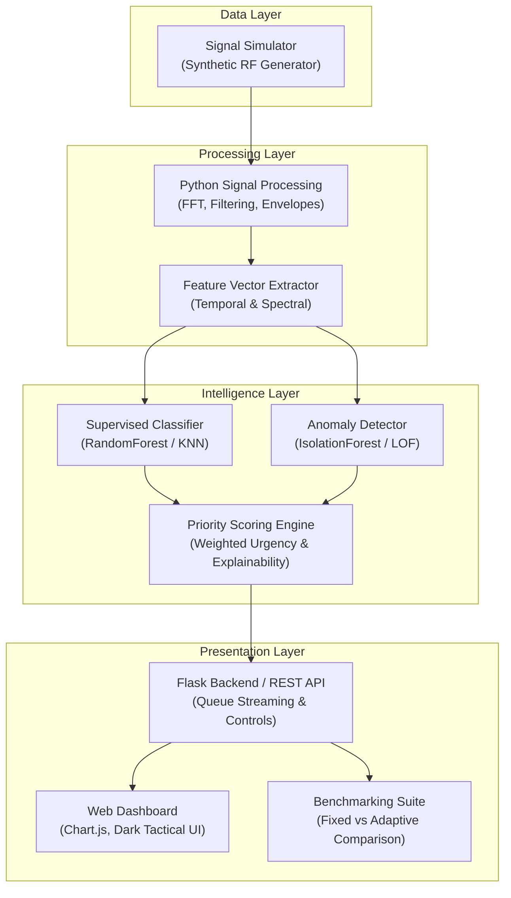

# SmartScan AI: Comprehensive Project Plan & Implementation Roadmap

> **Project Name**: SmartScan AI  
> **Sub-title**: Smart Scan Strategy for Electronic Warfare — AI-Powered Intelligent Signal Analysis and Prioritization  
> **Target Environment**: Windows Laptop / Local Workstation  
> **Repository**: [SampleProject](file:///c:/Users/nikil/Projects/SampleProject)  
> **Reference Presentation**: [presentation_notes.md](file:///c:/Users/nikil/Projects/SampleProject/docs/presentation_notes.md)

---

## 1. Executive Summary & Objective

In electronic warfare and signal monitoring operations, high bandwidth and dynamic spectral environments generate millions of electromagnetic pulses and signal bursts. Traditional systems process signals using fixed round-robin sweeps, static channel orders, or manual operator selection. This leads to latency bottlenecks, analyst cognitive fatigue, and the critical risk of overlooking novel or hostile electromagnetic emitters.

**SmartScan AI** provides an end-to-end, web-based prototype demonstrating **AI-assisted adaptive prioritization**:
- Mathematical simulation of realistic electromagnetic signal types (Radar pulses, Continuous Wave, Chirp/LFM, Frequency Hopping, and Unknown/Anomalous signals).
- Automated feature extraction using digital signal processing (DSP) in `NumPy` and `SciPy`.
- Hybrid machine learning: known pattern classification + unsupervised anomaly detection via `scikit-learn`.
- A dynamic priority engine with human-readable explainability logs.
- An interactive, dark-themed operations dashboard with live queue visualization and comparative benchmarking (Fixed-order vs. Adaptive).

---

## 2. System Architecture & Component Breakdown



### Component Roles & Responsibilities

1. **Signal Simulator (`simulator.py`)**:
   - Synthesizes I/Q or real-valued time-series signal buffers at configurable sampling rates ($f_s = 10\text{ MHz} - 100\text{ MHz}$ simulated).
   - Generates distinct signal classes:
     - `CW` (Continuous Wave / Carrier)
     - `PULSED_RADAR` (Pulse trains with variable Pulse Repetition Interval / PRI and Pulse Width / PW)
     - `CHIRP_LFM` (Linear Frequency Modulation radar chirps)
     - `FREQ_HOPPING` (Rapid discrete carrier frequency switching)
     - `NOISE_BACKGROUND` (Additive White Gaussian Noise / AWGN, Rayleigh fading)
     - `ANOMALY_UNKNOWN` (Novel modulations, burst collisions, corrupted pulses, phase jumps)
   - Configurable SNR (e.g. -5 dB to +25 dB) and random noise jitter.

2. **Digital Signal Processing & Feature Extraction (`dsp.py`)**:
   - Time-domain statistics: Peak amplitude, RMS, crest factor, zero-crossing rate.
   - Frequency-domain features via Fast Fourier Transform (FFT): Center frequency, 3dB/10dB bandwidth, spectral centroid, spectral rolloff, spectral entropy, peak-to-average power ratio (PAPR).
   - Pulse metrics: Estimated Pulse Width (PW), Pulse Repetition Frequency (PRF), duty cycle.

3. **AI / Anomaly Detection Module (`models.py`)**:
   - **Pattern Classifier**: Supervised model (`RandomForestClassifier` or `KNeighborsClassifier`) trained on labeled synthetic baseline signals.
   - **Novelty / Anomaly Detector**: Unsupervised model (`IsolationForest` or `LocalOutlierFactor`) that evaluates deviation from baseline signal feature distributions.
   - Outputs: Predicted class, classification confidence score $[0.0, 1.0]$, anomaly score $[-1.0, 1.0]$.

4. **Priority Scoring Engine (`priority_engine.py`)**:
   - Computes compound priority score $P \in [0, 100]$:
     $$P = w_a \cdot S_{\text{anomaly}} + w_t \cdot S_{\text{threat}} + w_u \cdot (1 - \text{Confidence}) + w_{\text{snr}} \cdot S_{\text{snr}}$$
   - Generates human-readable explanation tags (e.g., *"High PRI anomaly detected"*, *"Unfamiliar bandwidth profile"*, *"Low classification confidence; requires review"*).
   - Maintains an **Adaptive Priority Queue** dynamically reordered upon ingestion of each sample.

5. **Flask Backend & RESTful API (`app.py`)**:
   - RESTful API endpoints:
     - `POST /api/simulator/generate` - Trigger synthetic signal batches.
     - `GET /api/queue` - Retrieve current sorted review queue.
     - `GET /api/sample/<id>` - Retrieve detailed time-domain & FFT spectrum data for visualization.
     - `POST /api/sample/<id>/review` - Mark sample reviewed by operator.
     - `GET /api/benchmark/compare` - Run comparative analysis between adaptive queue and fixed-order scan.
     - `POST /api/settings` - Adjust priority weights and anomaly thresholds.

6. **Web Dashboard (`templates/index.html`, `static/`)**:
   - Tactical dark-mode user interface.
   - Real-time queue view with color-coded priority badges (Critical, High, Medium, Low).
   - Interactive Chart.js oscillogram (Time Domain) and power spectral density (Frequency Domain / FFT).
   - Explainability panel displaying contributing factors for priority assignment.
   - Benchmark dashboard comparing average review positions and latency.

---

## 3. Phased Implementation Roadmap

### Phase 1: Environment Setup & Project Scaffolding
- [ ] Configure Python 3.10+ virtual environment (`venv`).
- [ ] Install dependencies: `flask`, `numpy`, `scipy`, `scikit-learn`, `pytest`.
- [ ] Create directory structure (`backend/`, `frontend/`, `tests/`, `data/`).
- [ ] Set up configuration file (`config.py`).

### Phase 2: Synthetic Signal Simulator (`simulator.py`)
- [ ] Implement signal generation functions:
  - CW generator with frequency drift and AWGN.
  - Pulsed Radar pulse trains with variable PRI and duty cycles.
  - Linear Frequency Modulated (Chirp) pulses.
  - Frequency Hopping sequence generator.
  - Anomaly generators (frequency modulation distortion, phase discontinuities, exotic waveform shapes).
- [ ] Unit tests for signal generators with SNR calibration.

### Phase 3: DSP & Feature Extraction Pipeline (`dsp.py`)
- [ ] Implement FFT and Welch's power spectral density computation.
- [ ] Compute time-domain features (RMS, peak, crest factor, variance).
- [ ] Compute frequency-domain features (center freq, spectral bandwidth, spectral entropy).
- [ ] Compute pulse characteristics (rising edge detection, pulse width estimation).
- [ ] Package features into normalized feature vectors for ML models.

### Phase 4: Machine Learning & Anomaly Detection (`models.py`)
- [ ] Generate synthetic baseline training dataset ($N = 2000$ samples).
- [ ] Train multi-class classifier for known signal categories.
- [ ] Train Isolation Forest on baseline signal feature space for unknown pattern awareness.
- [ ] Evaluate model metrics (Precision, Recall, ROC-AUC).
- [ ] Serialize trained models (`pickle` / `joblib`).

### Phase 5: Dynamic Priority Scoring & Explainability Engine (`priority_engine.py`)
- [ ] Implement weighted scoring algorithm integrating:
  - Anomaly severity.
  - Threat tier mapping (e.g. pulsed tracking radar > surveillance CW).
  - Model classification uncertainty ($1 - \text{confidence}$).
- [ ] Implement explainability rule builder generating clear diagnostic rationale.
- [ ] Build adaptive priority queue data structure with sorting and triage tracking.

### Phase 6: Flask REST API Backend (`app.py`)
- [ ] Implement simulation controller routes.
- [ ] Implement queue management endpoints (fetch, inspect, acknowledge, dismiss).
- [ ] Implement benchmark execution endpoint (simulates batch under fixed-order vs adaptive review).
- [ ] Error handling and input validation.

### Phase 7: Interactive Web Dashboard (`templates/` & `static/`)
- [ ] Responsive modern layout:
  - Header with system status, active signal rate, and quick controls.
  - Left pane: Adaptive review queue list with urgency color coding.
  - Center pane: Time-domain waveform and FFT spectrum charts (Chart.js).
  - Right pane: Signal details, ML predictions, and explainability breakdown.
  - Bottom pane: Performance Comparison modal / chart (Fixed vs Adaptive scan).
- [ ] Connect frontend to Flask API via fetch requests / polling.

### Phase 8: Benchmarking, Validation & Verification
- [ ] Benchmark test suite:
  - Compare **Average Review Position of Flagged Samples** (Adaptive vs Fixed-Order).
  - Measure **Classification Accuracy** on test splits.
  - Measure **False-Alarm Rate** under noisy conditions.
  - Measure **Processing Time** per sample on Windows host machine.
- [ ] Document results and prepare demonstration scripts.

---

## 4. Verification & Testing Metrics (Slide 9 Alignment)

| Metric | Target / Benchmark Criterion | Formula / Measurement Method |
| :--- | :--- | :--- |
| **Average Review Position (ARP)** | $\ge 60\%$ reduction in review rank for critical/anomalous signals | $\text{ARP}_{\text{adaptive}} \ll \text{ARP}_{\text{fixed-order}}$ |
| **Classification Accuracy** | $\ge 90\%$ accuracy across known simulated classes | Correctly classified / Total known samples |
| **False Alarm Rate (FAR)** | $\le 10\%$ false anomaly triggers on standard signals | Normal signals incorrectly flagged as anomalies / Total normal signals |
| **Processing Time** | $< 15\text{ ms}$ feature extraction + inference per sample | Measured via `time.perf_counter()` on host CPU |

---

## 5. Technology Stack & Package Versions

- **Python**: 3.10 - 3.12
- **Backend Framework**: `Flask >= 3.0.0`
- **Numerical Computing**: `numpy >= 1.24.0`
- **Signal Processing**: `scipy >= 1.10.0`
- **Machine Learning**: `scikit-learn >= 1.3.0`
- **Visualization Library**: `Chart.js v4.4.x` (bundled or CDN)
- **Database**: SQLite3 (standard library)

---

## 6. Directory Layout Structure

```
c:\Users\nikil\Projects\SampleProject\
├── docs/
│   └── presentation_notes.md       # Presentation transcription
├── src/
│   ├── __init__.py
│   ├── config.py                  # Simulation & model hyperparameters
│   ├── simulator.py               # Synthetic electromagnetic signal generator
│   ├── dsp.py                     # FFT and feature extraction algorithms
│   ├── models.py                  # ML classification and anomaly models
│   ├── priority_engine.py         # Priority scoring and explainability logic
│   ├── app.py                     # Flask web server and REST API
│   ├── static/
│   │   ├── css/
│   │   │   └── style.css          # Dark tactical theme styling
│   │   └── js/
│   │       ├── dashboard.js       # UI interactions and queue rendering
│   │       └── charts.js          # Chart.js waveform & spectrum renderers
│   └── templates/
│       └── index.html             # Main operator dashboard view
├── tests/
│   ├── test_simulator.py          # Unit tests for signal generation
│   ├── test_dsp.py                # Unit tests for feature extraction
│   └── test_priority.py           # Unit tests for priority scoring
├── README.md                      # Project introduction & quickstart
├── PROJECT_PLAN.md                # This document
└── requirements.txt               # Python package dependencies
```
