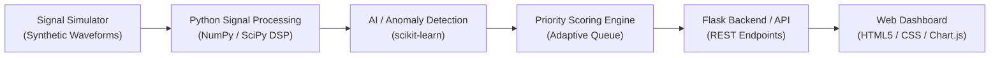

# SmartScan AI

> **Smart Scan Strategy for Electronic Warfare: AI-Powered Intelligent Signal Analysis and Prioritization**  
> *A prototype system for simulated electromagnetic signal prioritization, anomaly detection, and explainable operator triage.*

---

## 🎯 Overview

In modern electromagnetic and signal intelligence environments, receiving systems are flooded with continuous, high-volume signal streams. Analyzing every incoming signal uniformly with fixed-order sweeps strains computational resources and operator attention, causing critical anomalies or high-threat signals to sit waiting in queues.

**SmartScan AI** introduces an adaptive prioritization architecture that:
1. **Generates & Ingests** simulated electromagnetic signals (pulsed radar, continuous wave, chirp/frequency sweep, frequency-hopping, and synthetic anomalies).
2. **Extracts Key Signal Features** using digital signal processing (DSP) in `NumPy` and `SciPy` (center frequency, bandwidth, pulse width, SNR, spectral entropy).
3. **Identifies Knowns & Novelties** via machine learning models (`scikit-learn`) combining multi-class classification and unsupervised anomaly detection.
4. **Calculates Adaptive Priority Scores** combining anomaly novelty, threat weight, and confidence metrics with transparent explanations.
5. **Streams Results to an Operator Dashboard** featuring dynamic queue re-ranking, waveform and spectrum visualization (`Chart.js`), and a direct benchmark comparison against legacy fixed-order scanning.

> ⚠️ **Note on Scope**: This prototype operates strictly on **synthetic, mathematical signal data** and is built for educational, hackathon, and laboratory research purposes. It does not interface with operational military or tactical hardware.

---

## 🧩 Architecture



### Data Pipeline Flow
$$\text{Synthetic Signal Generation} \longrightarrow \text{Feature Extraction} \longrightarrow \text{ML Classification \& Anomaly Scoring} \longrightarrow \text{Dynamic Queue Prioritization} \longrightarrow \text{Visual Dashboard}$$

---

## 🛠️ Technology Stack

| Layer | Technologies | Purpose |
| :--- | :--- | :--- |
| **Backend & API** | Python 3.10+, Flask | Core service, REST API, orchestration |
| **Signal Processing (DSP)** | NumPy, SciPy | FFT, filtering, envelope detection, feature extraction |
| **Machine Learning** | scikit-learn | Multi-class signal classifier & anomaly detectors |
| **Frontend / UI** | HTML5, CSS3, Modern JavaScript | Operator interface, queue management |
| **Data Visualization** | Chart.js | Time-domain oscillogram & frequency spectrum views |
| **Storage (Optional)** | SQLite | Storing signal logs, run histories, and benchmark scores |
| **Environment** | VS Code, Windows OS | Development and local execution |

---

## 📁 Repository Structure

```
SampleProject/
├── docs/
│   └── presentation_notes.md       # Exact slide-by-slide transcription and details
├── README.md                       # Project overview and architectural blueprint
└── PROJECT_PLAN.md                 # Detailed phased implementation roadmap and tasks
```

---

## 📊 Verification & Benchmark Metrics

SmartScan AI measures its effectiveness directly against traditional fixed-order review using the same simulated signal sets:
- **Average Review Position of Flagged Samples**: Verifies that urgent/anomalous samples are brought to the front of the queue significantly faster.
- **Classification Accuracy**: Evaluates accuracy in distinguishing baseline signal types.
- **False-Alarm Rate**: Tracks erroneous priority spikes to prevent operator alert fatigue.
- **Processing Latency**: Ensures real-time feasibility on commodity laptop hardware.

---

## 📖 Further Reading
- [Project Plan](file:///c:/Users/nikil/Projects/SampleProject/PROJECT_PLAN.md)
- [Slide Presentation Transcript](file:///c:/Users/nikil/Projects/SampleProject/docs/presentation_notes.md)
